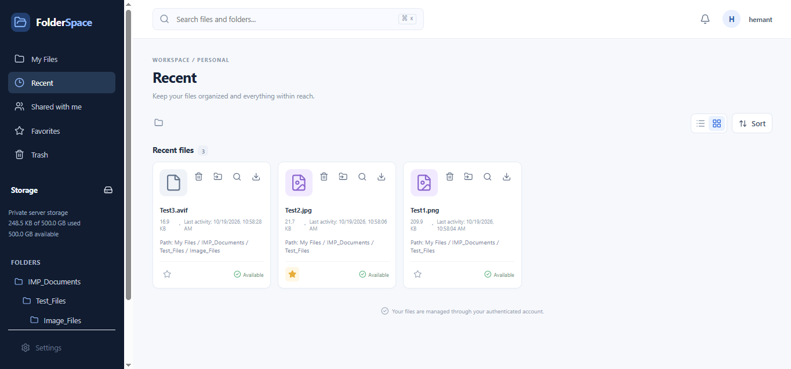

<div align="center">

# 📁 FolderSpace

### A modern, self-hosted file and folder manager

Organize files, browse nested folders, preview uploads, save favorites, and recover deleted files — all from a clean web interface.


**A ready-to-customize foundation for your own file manager.**

</div>

---

## 🖥️ Preview



## ✨ Features

- **Files & folders:** Create nested folders, browse with breadcrumbs, upload, move, search, and download files.
- **Preview:** Preview supported files directly in the app.
- **Recent:** Quickly find recently accessed or uploaded files, with activity time and folder path.
- **Favorites:** Keep frequently used files close at hand.
- **Trash & recovery:** Restore deleted files or permanently remove them. A cleanup command supports retention-based deletion.
- **Personalization:** Light/dark themes, font-size controls, compact layout, and view preferences.
- **Storage overview:** See used space against a configurable sample capacity.
- **Extensible structure:** React frontend and Django REST backend, ready for further development.

> **Note:** Automatic 30-day Trash cleanup only happens after you schedule the cleanup command on your host. “Shared with me” is a future extension unless sharing APIs and permissions have been implemented.

## 🧰 Tech stack

- **Frontend:** React, Vite, JavaScript, CSS
- **Backend:** Python, Django, Django REST Framework
- **Storage:** Configured server/local filesystem
- **Database:** Use the database configured in your Django settings

## 🚀 Run locally

### 1. Clone the repository

```bash
git clone https://github.com/hemantkarne70-tech/Folder-Manager-UI.git
cd Folder-Manager-UI
```

### 2. Start the backend

Open a terminal in the directory containing `manage.py`, then run:

```bash
python -m venv venv
```

Activate the environment:

```powershell
# Windows PowerShell
.\venv\Scripts\Activate.ps1
```

Install dependencies (if `requirements.txt` is present), migrate, and start Django:

```bash
pip install -r requirements.txt
python manage.py migrate
python manage.py check
python manage.py runserver
```

### 3. Start the frontend

In a second terminal, enter the `frontend` directory:

```bash
npm install
npm run dev
```

Open the local URL printed by Vite (commonly `http://localhost:5173`). Ensure `frontend/src/api/client.js` points to your Django API, commonly `http://127.0.0.1:8000/api` during development.

> If your repository uses a different backend path or does not include `requirements.txt`, adjust these commands to match your current project structure.

## 🗑️ Optional: schedule Trash cleanup

Run this from the backend directory to clean up expired Trash items manually:

```bash
python manage.py cleanup_trashed_files
```

To make it automatic, schedule the command daily with Windows Task Scheduler or cron. Test it manually first.

## 🔐 Before production

- Configure `DEBUG`, `ALLOWED_HOSTS`, secrets, HTTPS, and CORS/CSRF correctly.
- Verify that every file operation enforces authentication, ownership, and permissions.
- Back up both your database and uploaded files.
- Treat the storage capacity shown in the UI as informational unless backend quota enforcement is implemented.
- Implement and test secure sharing permissions before enabling shared-file workflows.

## 💡 Ideas for future improvements

Secure file sharing • User quotas • Cloud storage • File versioning • Audit logs • Docker deployment • Automated tests

## 🤝 Contributing

Ideas and improvements are welcome. Open an issue with details, or submit a pull request with a clear description of your changes.

## 📄 License

Add a `LICENSE` file before publishing terms for reuse. Until then, do not assume the project is licensed for redistribution.

---

<div align="center">

⭐ If FolderSpace is useful to you, consider starring the repository!

**Built by [Hemant Karne](https://github.com/hemantkarne70-tech)**

</div>
